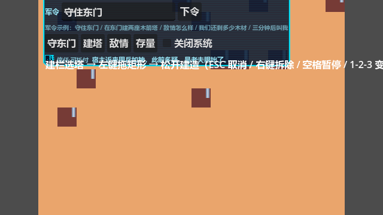
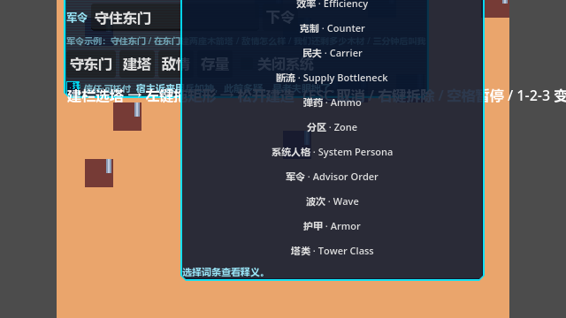
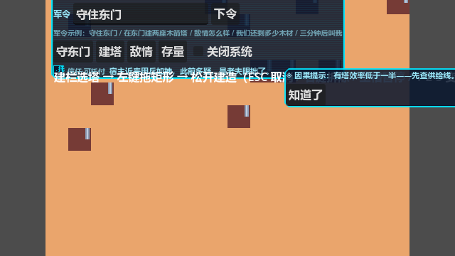

# 我在游戏觉醒系统 · EraTD

**Awakened System TD — *The System is real.***

[](https://github.com/leewang246731-beep/awakened-system-td/actions/workflows/ci.yml)

一条生产链，一座城，一个真的会说话的系统。你在这座 besieged 大陆上醒来，脑中响起一道电子音：**"叮！系统绑定成功。"** 从石斧到星舰，每一发弹药都要自己采、自己造、自己运——而你要做的，只是对系统下一道命令："守住东门""多囤火油矢""下一波怕什么？"——系统会查战局、出方案、等你点头、合法执行。

**生产链塔防 × 六时代战役 × 游戏内智能体（AI 军师，可选 BYOK）**。Godot 4.7 + C# 制作，代码 MIT / 美术音频资产 CC BY-NC，**永久免费，无任何付费项**。

> 当前版本 **v0.2.0-alpha（视觉扩充版）**：首发两章（E1 远古 / E2 古典）可玩 + 五层 51 条过场视频、记忆图鉴与隐藏篇《零的真相》、六时代皮肤/加载图/立绘/成就图标。后续章节、Web 版与模组管线开发中。

## 特性

- **物流即防御**：塔吃弹药，弹药靠链条（采集 → 加工 → 运输 → 装填）；断链减速不停摆，经济断点看得见。
- **时代即关卡**：六大时代（远古 → 古典 → … → 星际）= 大陆战役图 + 能源/物流规则 + 科技树；时代跃迁是最大爽点，旧城墙化为遗迹，千年后你能亲手挖出自己当年布下的防线。
- **觉醒系统（游戏内智能体）**：对系统下"军令"——离线军令语法开箱即用，不配任何 Key；自然语言对话为可选 AI 档（BYOK，自带 API Key）。系统只用封闭动作清单（19 个带 Schema 校验的合法动作），方案卡出招、你审批、点数限量，**永不乱创造**；系统可完全关闭，全成就全通关不受影响。
- **确定性模拟核心**：纯 C# 逻辑库（零引擎依赖）驱动，同种子 + 同命令流 → 完全一致的世界；回放、存档、断线恢复共享同一条确定性管线。
- **内容即模组**：塔 / 敌人 / 波次 / 科技 / 音频参数全部 JSON 数据驱动，模组新塔自动进入系统可指挥范围。
- **六层质量门禁**：4400+ 单元/逻辑/集成测试 + 红线扫描 + 资产规格校验 + headless 冒烟，本地一键流水线与 GitHub Actions CI 同序同判据。

## 截图（v0.1.0-alpha）

| 战斗 HUD（军令面板） | 帮助面板 | 因果提示气泡 |
|---|---|---|
|  |  |  |

## 快速开始（玩家）

1. 到 [Releases](https://github.com/leewang246731-beep/awakened-system-td/releases) 下载最新 `EraTD-v0.2.0-alpha-win64.zip`（免登录，直接点即下；另附可选的 480p 视频母片合集）。
2. 解压到任意可写目录（不要放进 `Program Files`）。
3. 双击 `EraTD.exe` 运行。存档与战报写在 exe 旁的 `saves\` 目录，卸载=删目录。
4. 玩不动了？游戏内按帮助（`F1`）看三层信息层；对系统下一句"守住东门"试试。

**AI 对话档（可选）**：设置页填入你自己的 OpenAI 兼容 API Key（智谱 GLM / MiMo 等已预置模板）。不配 Key 时军令语法档完整可玩。首次启用前会弹一次**数据流向声明**（对话内容只发往你配置的服务、不收集遥测、随时可关），设置页常驻"你的话发给谁"三档对比条。**注意：Coding Plan（套餐包月）密钥不能用于本游戏**——服务端会返回错误码 1315，请使用按量计费的 API Key；详见下方[免责与科普](#免责与科普ai-档说明)。

### 镜像下载

- **主渠道**：[GitHub Releases](https://github.com/leewang246731-beep/awakened-system-td/releases)（免登录直下，全部版本与文件以此为准）。
- **国内备用**：GitHub 访问不畅时可自行选用任意可信的 GitHub 加速/镜像服务转发下载链接（请自行甄别，本仓库不指定、不背书任何第三方转包）；官方国内直连页（itch.io）上线后将在本节补充直达链接。
- 无论从哪个渠道下载，校验与版本信息一律以 GitHub Releases 页面为准。

## 构建（开发者）

需要：.NET SDK 8、Godot 4.7.2-stable mono（编辑器 + 导出模板）。完整环境清单与一键装机脚本见 [`docs/engineering/23-migration-plan.md`](docs/engineering/23-migration-plan.md)（新机迁移方案），工具链事实登记见 [`docs/engineering/09-env-locked.md`](docs/engineering/09-env-locked.md)。

```bash
git clone https://github.com/leewang246731-beep/awakened-system-td.git
cd awakened-system-td

# 全解决方案构建（Release，零警告门禁）
dotnet build game/EraTD.sln -c Release

# 一键质量门禁：红线扫描 → 资产校验 → 全量测试 → 构建 → Godot headless 冒烟
bash tools/ci/run_all.sh

# 打 v0.2 Windows 包（视觉扩充版；导出模板就位、图片聚合已入库后）
bash tools/release/build_v020.sh
```

架构要点：`game/src/EraCore`（纯逻辑库，零 Godot 依赖）+ `game/presentation/EraTD`（唯一 res:// 根）+ `game/content`（JSON 数值注册表）。规范见 [`docs/CODE_STANDARDS.md`](docs/CODE_STANDARDS.md)。

## 许可证

双许可证（详见 [`LICENSE`](LICENSE) 与 [`ASSETS-LICENSE`](ASSETS-LICENSE)）：

- **代码**：[MIT License](LICENSE)，版权 2026 leewang246731-beep。
- **美术 / 音频资产**（`game/presentation/EraTD/textures`、`audio`、`cinematics` 等随包分发的资产）：[CC BY-NC 4.0](https://creativecommons.org/licenses/by-nc/4.0/)——署名 + 非商业使用。**NC 边界**：你可以自由游玩、直播、录视频、写攻略（这些不算商业使用资产本身）；但不得将资产本身或其改编用于商业目的（如出售素材包、把美术塞进付费商品）。第三方 CC0 素材（Kenney 等）保持 CC0 公有领域状态，清单见 ASSETS-LICENSE。

## 免责与科普（AI 档说明）

- 本游戏**永久免费、无任何付费项、无内购无广告**；AI 对话档的服务器费用由玩家自担（BYOK——Bring Your Own Key，自带按量 API Key）。
- **Coding Plan 白名单限制**：智谱等厂商的"Coding Plan / 套餐包月"密钥只能在其官方编程工具内使用，**不能**调用本游戏的对话接口——会收到 HTTP 429 + 错误码 1315。请使用**按量计费 API Key**。本提示同时写在游戏设置页与 429-1315 错误文案里。
- AI 档完全可选：关闭系统可全通关、全成就，警报与军令语法档不缺失。
- v0.2.0-alpha 已知问题：①内容量为首发两章（E1+E2）；②界面双语混排（中文为主，部分文案仍为英文），完整本地化随后续版本收口；③ AI 档需自配 Key（见上）；④ Boss/奇观等部分视频触发位待后续系统任务接线（素材与播放接口已内置）。
- **AI 生成内容披露（商店物料口径，中英一致）**：本作**部分视觉素材**（章节插画/加载图/皮肤/军师立绘/过场视频母片）**由生成式 AI 生成后经人工筛选入库**（AI-generated assets, human-curated；游戏代码与关卡逻辑非 AI 生成）；逐条生成台账（manifest）随包分发，见 `game/assets/expand-v1/` 下各 manifest。游戏内设置页与关于标注同措辞。
- **BYOK 数据流向披露**：AI 对话档（L3）启用后，对话内容仅发送至玩家自己配置的服务地址（`base_url`），游戏本体不收集遥测、不上报玩家数据；API Key 仅存本机凭据存储。首次启用前弹数据流向声明（确认一次后不再弹，关闭 AI 档则永不弹），设置页常驻"你的话发给谁"L1/L2/L3 三档对比条。
